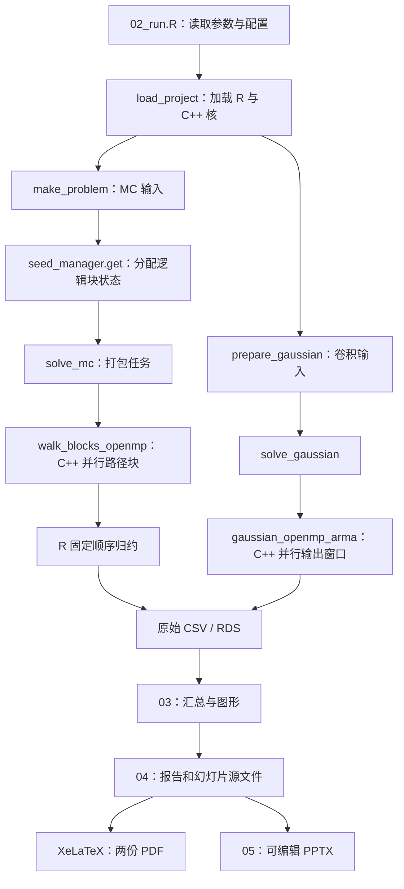

# 代码说明：反向随机游走与 Gaussian 直接卷积

本文解释 Guisheng Dai 负责的前两种解法及其配套实验程序。说明以当前 [R 代码](R/)、[C++ 代码](src/) 和 [实验脚本](scripts/) 为准；有限差分法和 PINN 由合作者负责，不属于本文的实现范围。

本文按“整体调用关系 → 公共数据 → 随机游走 → 卷积 → 并行 → 实验与输出”的顺序展开。代码中的许多函数很短，但分开存放，是为了让模型、数值算法、验证和实验组织各有清楚的入口。

**工作目录约定：**以下运行命令和代码中的相对路径，都以 `guisheng-dai/` 为根。从 repository 根目录开始时，先执行：

```powershell
Set-Location guisheng-dai
```

## 阅读导航

1. [整体结构与调用链](#1-整体结构与调用链)
2. [模型、变量和数组下标](#2-模型变量和数组下标)
3. [环境、配置和编译](#3-环境配置和编译)
4. [公共模型函数](#4-公共模型函数)
5. [反向随机游走的数学含义](#5-反向随机游走的数学含义)
6. [随机游走的 R 与 C++ 实现](#6-随机游走的-r-与-c-实现)
7. [随机流和可复现性](#7-随机流和可复现性)
8. [Gaussian 卷积与零边界](#8-gaussian-卷积与零边界)
9. [卷积数组与滑窗实现](#9-卷积数组与滑窗实现)
10. [OpenMP 并行机制](#10-openmp-并行机制)
11. [正确性测试](#11-正确性测试)
12. [实验主程序与计时](#12-实验主程序与计时)
13. [原始记录与统计汇总](#13-原始记录与统计汇总)
14. [报告与 PPT 生成](#14-报告与-ppt-生成)
15. [可直接运行的调用示例](#15-可直接运行的调用示例)
16. [修改代码时的注意事项](#16-修改代码时的注意事项)

## 1. 整体结构与调用链

### 1.1 文件分别负责什么

```text
guisheng-dai/
├── config.R                         实验重复数、线程数和主种子等配置
├── R/
│   ├── bootstrap.R                  环境设置、模块加载、Rcpp 编译
│   ├── problem.R                    初值、解析参照、网格和转移概率
│   ├── random_walk.R                R 路径参考、离散矩阵参照、MC 包装
│   ├── gaussian_convolution.R       R 滑窗参考、核准备和卷积包装
│   ├── rng.R                        固定逻辑任务的 CMRG 随机流管理
│   ├── parallel.R                   实际 OpenMP 线程数核验
│   └── metrics.R                    误差、墙钟计时、CSV 与记录合并
├── src/
│   ├── random_walk.cpp              串行参考核、CMRG 与 OpenMP 路径块
│   └── gaussian_convolution.cpp     核/奇延拓准备、Armadillo 滑窗与 OpenMP
├── scripts/
│   ├── 00_setup.R                   预先编译 C++ 核心
│   ├── 01_tests.R                   串行小规模正确性测试
│   ├── 01_openmp_tests.R            单独的并行集成核验
│   ├── 02_run.R                     E1—E6 实验与原始记录
│   ├── 03_summarise_plot.py         统计汇总、科学图形与图表数据
│   ├── 04_build_documents.py        报告/Beamer 源文件与幻灯片内容
│   └── 05_build_pptx.py             可编辑 PPTX 与内嵌图表数据
├── results/                         参数快照、随机状态、原始记录与汇总
├── report/                          报告、演示稿、图形和模板
│   └── build_documents.ps1          文稿生成与编译入口
└── requirements.txt                 Python 后处理依赖
```

这里有三条不同的执行路线：

- **求解路线：**R 建立输入，调用 C++ 求解器；C++ 中的 OpenMP 执行并行计算，结果回到 R。
- **验证路线：**R 参考实现、手算结果、矩阵期望和解析参照检查求解器。
- **展示路线：**Python 读取已经保存的结果，生成图表、报告源文件和演示稿。

Python 绘图程序不负责生成正式 PDE 数值解。报告中的数值来自保存的实验记录，而不是排版时重新模拟。

### 1.2 一次正式运行经过哪些函数



如果阅读器不支持 Mermaid，也可以按上面的节点名称直接查找对应函数。所有求解器都可以单独调用，不必先跑完 E1—E6。

## 2. 模型、变量和数组下标

### 2.1 程序求解的问题

主问题是

$$
u_t=a u_x+D u_{xx},\qquad 0<x<1,
$$

$$
u(0,t)=u(1,t)=0,\qquad u(x,0)=f(x).
$$

当前主参数为

$$
a=0.2,\qquad D=0.05,\qquad T=0.5.
$$

`a` 是漂移系数，`D` 是扩散系数，`T` 是要求解的终止时刻。这里的 `D` 对应原设想中的 $\sigma^2$。因为 PDE 写成 $+a u_x$，后向随机路径的平均增量是向右的 $a\tau$，不要把它和实线信号向左移动的方向混淆。

主初值选择

$$
f(x)=e^{-a x/(2D)}\sin(\pi x),
$$

对应解析解

$$
u_\star(x,T)
=e^{-a x/(2D)-a^2T/(4D)-D\pi^2T}\sin(\pi x).
$$

它既满足初值，也满足两端零边界，适合检查程序是否实现了预定问题。

### 2.2 容易混淆的几个数量

- `N`：空间被分成多少段，不是内部节点数。数组共有 `N+1` 个节点，内部节点有 `N-1` 个。
- `h=1/N`：空间步长。
- `n`：随机游走的最多时间步数；`dt=T/n` 或数学记号 $\tau$ 是时间步长。
- `M`：**每个查询点、每次独立估计**的路径数。查询 8 个点时，总预算为 `8*M` 条路径。
- `K`：Gaussian 核左右各覆盖的格点数。
- `W=2*K+1`：整个卷积核的长度。
- `c`：Gaussian 核覆盖多少个扩散标准差，是控制物理半径的参数。
- `p`、`threads`：OpenMP 线程数；概率向量在代码中叫 `probs`，低层循环中叫 `pm,p0,pp`。
- `rep`：原始记录中的重复编号。它代表随机独立批次还是性能计时轮次，要同时看 `experiment` 和 `phase`。

### 2.3 数学节点、R 下标和 C++ 下标

节点为 $x_j=j/N$，$j=0,\ldots,N$。C++ 从 0 开始编号，R 从 1 开始编号：

```text
数学节点 j：     0       1       2       ...       N
物理位置：      0      1/N     2/N      ...       1
C++ f[j]：      f[0]   f[1]    f[2]     ...      f[N]
R f[j+1]：      f[1]   f[2]    f[3]     ...      f[N+1]
```

传给求解器的 `query_j` 采用数学/C++ 节点编号。它不是 R 向量下标。例如，查询 $x=1/8$、`N=16` 时，`query_j=2`；在 R 中读取初值要写 `f[3]`。

`query_indices(x,N)` 将物理位置转换成节点编号，并要求位置确实落在网格上。它不做插值。自行调用时优先用这个函数，避免小数被强制转成整数后查询了错误位置。

## 3. 环境、配置和编译

### 3.1 `R/bootstrap.R`：公共加载入口

源码：[R/bootstrap.R](R/bootstrap.R)。

文件开头设置：

```r
Sys.setenv(OMP_DYNAMIC="FALSE", OMP_MAX_ACTIVE_LEVELS="1", OMP_WAIT_POLICY="PASSIVE",
           OPENBLAS_NUM_THREADS="1", MKL_NUM_THREADS="1")
```

这些设置的用途是：

- 关闭 OpenMP 动态调整，配合实际线程数检查，使请求的 1/2/4 线程有明确含义。
- 限制嵌套活跃并行层数，避免外层 OpenMP 中又启动一组线程。
- 使用被动等待策略，减少空闲等待线程持续占用计算资源。
- 将相关 BLAS 库限制为单线程，避免一次内积又产生额外的库线程。

设置环境变量不等于已经启动并行。真正创建线程组的是 C++ 中的 `#pragma omp parallel`。

接着用 `requireNamespace()` 检查 `Rcpp` 和 `RcppArmadillo` 是否存在。缺失时报告错误，不在求解或计时过程中临时安装依赖。

`compile_kernels()` 对两个 `.cpp` 文件调用：

```r
Rcpp::sourceCpp(f, cacheDir=".cache/rcpp", rebuild=FALSE,
                showOutput=FALSE, verbose=FALSE)
```

`sourceCpp()` 编译 C++ 并生成可以从 R 调用的包装函数。缓存放在 `.cache/rcpp`；`rebuild=FALSE` 表示允许复用有效缓存，并非忽略源码更新。编译放在准备阶段，避免混入正式求解计时。

`load_project(compile=TRUE)` 先加载各个 R 模块，再编译或加载 C++ 核。模块中的函数定义可以先引用稍后才加载的函数，因为这些函数要到实际调用时才执行。

### 3.2 C++ 文件开头的 Rcpp 注释

```cpp
// [[Rcpp::plugins(cpp17)]]
// [[Rcpp::plugins(openmp)]]
// [[Rcpp::depends(RcppArmadillo)]]
// [[Rcpp::export]]
```

它们看起来是注释，但 `sourceCpp()` 会读取：

- `cpp17`：要求相应的 C++ 语言标准。
- `openmp`：启用编译和链接所需的 OpenMP 支持。
- `depends(RcppArmadillo)`：加入该库所需的编译依赖；只用于需要 Armadillo 的文件。
- `export`：为紧随其后的 C++ 函数生成 R 调用入口。

例如，导出的 `walk_blocks_openmp(...)` 可以在加载后直接作为 R 函数调用，无须自己编写 `.Call()` 包装。

### 3.3 `config.R`：控制实验重复与规模策略

源码：[config.R](config.R)。`experiment_config(mode,threads)` 返回一个列表。正式模式中：

```r
mc_reps = 30L
timing_reps = 7L
batch_target = 0.2
parallel_degrees = c(1L,2L,4L)
```

含义分别是 30 批独立 MC 重复、7 轮性能计时、短任务批量计时的目标时长，以及性能实验使用的线程数。`seed=20261116L` 是固定主种子，不是每次运行当天的日期。

smoke 模式将它们缩小为 3 批随机重复、2 轮计时、0.04 秒批量目标，并且只使用 1 线程，用来检查程序流程。

**当前实现的边界：**配置中保存了 `a,D,T`，但实验主程序建立问题时主要使用 `make_problem()` / `prepare_gaussian()` 的默认参数，没有把 `cfg$a,cfg$D,cfg$T` 全部向下传递。因此，单独修改配置列表中的三个数，并不能保证整个实验已经切换到新 PDE。第 16 节说明需要一起修改的位置。

### 3.4 入口 `00_setup.R`

源码：[scripts/00_setup.R](scripts/00_setup.R)。这个脚本只加载启动文件、编译两个 C++ 核并打印 `sessionInfo()`。它不执行 E1—E6，也不生成图表。

## 4. 公共模型函数

源码：[R/problem.R](R/problem.R)。

### 4.1 `initial(x,profile,a,D)`

函数返回给定位置的初值，`x` 可以是一个位置，也可以是一组位置。

- `profile="main"`：$e^{-a x/(2D)}\sin(\pi x)$。
- `profile="poly"`：$e^{-a x/(2D)}x(1-x)$。

代码先计算正弦或多项式部分，再乘上指数因子。当前判断是 `profile=="poly"` 时选择多项式，否则使用正弦分支，所以调用时应使用约定的两个名称。

### 4.2 `exact(x,T,a,D,profile,highest)`

主初值使用上一节的解析公式。多项式初值则使用正弦级数参照：

$$
u_{\rm poly}(x,T)=e^{-a x/(2D)-a^2T/(4D)}
\sum_{k=1,3,5,\ldots}
\frac{8}{\pi^3k^3}e^{-D(k\pi)^2T}\sin(k\pi x).
$$

`highest=63L` 表示求和到最高奇数波数 63。代码中的 `outer(x,k*pi)` 建立所有位置与波数的乘积矩阵，`sin(...) %*% coefficients` 一次算出整组位置的级数值。

多项式分支在代码中是**有限谱截断参照**。函数名为 `exact`，不代表有限项级数在任意条件下都没有截断误差。E4 用最高波数 31 和 63 的一致性检查，确认本轮参数下参照已足够稳定。

`T=0` 时直接返回初值，避免用有限级数逼近原本已经知道的初始函数。

### 4.3 `make_problem(N,n,profile,a,D,T)`

这个函数建立问题上下文 `ctx`，其中包括：

```text
N, n       空间段数与路径最多步数
x, f       长度 N+1 的坐标和初值
a, D, T    PDE 参数与终止时刻
h, dt      空间和时间步长
probs      按“左、停、右”排列的转移概率
profile    初值类型
```

核心计算是：

```r
r <- D*(T/n)*N^2
b <- a*(T/n)*N/2
probs <- c(r-b, 1-2*r, r+b)
```

由于 $h=1/N$，这对应 $r=D\tau/h^2$、$b=a\tau/(2h)$。两端初值显式赋成 0，避免 `sin(pi)` 的浮点残差被当成非零边界。

`make_problem()` 检查基本的网格和参数条件，但不直接调用 `check_probs()`。MC 求解器和矩阵参照会在使用概率前检查它。Gaussian 准备函数也借用 `make_problem()` 建立网格，但并不使用路径概率，因此不需要满足随机游走的时间步限制。

特别注意：`make_problem()` 的 `n` 默认值是 1，并不会自动为任意 `N` 选择稳定步长。单独调用 MC 时需要传入合适的 `n`。

### 4.4 `check_probs(p)` 与 `query_indices(x,N)`

`check_probs()` 要求三个数有限、非负，且和与 1 的差不超过 `1e-14`。不满足时立即报错，不把负概率强行剪成 0，也不重新归一化。

`query_indices()` 检查位置位于 `[0,1]`，并要求 `x*N` 与最近整数的差小于 `1e-10`。之后返回整数节点编号。

## 5. 反向随机游走的数学含义

### 5.1 从离散更新到随机路径

中心差分和前向时间差分给出

$$
U_j^{m+1}=p_-U_{j-1}^m+p_0U_j^m+p_+U_{j+1}^m,
$$

$$
p_-=r-b,\qquad p_0=1-2r,\qquad p_+=r+b.
$$

只要三个系数是合法概率，就可以将它理解为：从节点 `j` 出发，每步左移、停留或右移一个格点，最后读取初值。

“反向”的意思是从要求解的位置回溯到初值，而不是把所有初始粒子向前推进。代码用递增的循环变量执行这个回溯过程，不需要真的将计算机中的时间变量递减。

### 5.2 一条路径的收益

每条路径最多执行 `n` 步。一旦到达 `0` 或 `N`，立即吸收，收益记为 0。走完 `n` 步且未触边时，收益为最后位置的初值：

$$
Y=f(X_n)\mathbf1_{\{\text{未触边}\}}.
$$

使用全部 `M` 条路径估计：

$$
\widehat u_j=\frac{1}{M}\sum_{k=1}^M Y_k.
$$

分母包含被吸收的零收益路径。如果改成除以 `alive`，估计的将是条件于幸存的平均收益，已经不是本问题的解。

每一步都检查触边也很重要。只抽取一个高斯终点，不能辨认“中途已触边，最后又回到区间内”的轨迹，因此不能替代当前吸收路径模拟。

### 5.3 哪种误差来自 MC，哪种来自离散

随机游走估计的是离散链的期望 $U_{\rm disc}$。即使路径无限多，固定网格和时间步下也未必等于连续解 $u_\star$。

设单条路径收益方差为 $v$，则

$$
\mathbb E[(\widehat u-u_\star)^2]
=(U_{\rm disc}-u_\star)^2+\frac{v}{M}.
$$

第一项是离散偏差平方，第二项是抽样方差。实验同时保存两种参照，才能分辨“路径不够多”和“离散网格不够细”。

## 6. 随机游走的 R 与 C++ 实现

### 6.1 `walk_block_r()`：便于核对的串行版本

源码：[R/random_walk.R](R/random_walk.R)。函数签名为：

```r
walk_block_r(f, j, n, probs, M)
```

外层循环遍历路径，内层循环遍历该路径的时间步：

```r
z <- runif(1)
if(z < probs[1]) pos <- pos-1L
else if(z >= probs[1]+probs[2]) pos <- pos+1L
```

没有进入左、右两个分支时，`pos` 保持原值，也就是停留。执行一步后，先增加步数统计，再检查是否触边，所以 `sum_steps` 包括导致吸收的那一步。

函数只累计五个统计量：

- `M`：该块的全部路径数。
- `sum_y`：所有收益之和。
- `sum_y2`：所有收益平方之和。
- `alive`：执行结束时未被吸收的路径数。
- `sum_steps`：所有路径真正执行的步数总和。

不保存完整轨迹，使内存成本不随路径长度和路径总数一起增长。R 参考版本主要用于检查逻辑，不用于正式性能排名。

### 6.2 `walk_block_cpp()`：与 R 随机流直接核对

源码：[src/random_walk.cpp](src/random_walk.cpp)。它与 R 参考版采用同样的路径和时间循环，使用 `R::runif(0,1)`。

这个函数是**串行核验版本**。测试程序先保存 R 的 `.Random.seed`，运行 R 版本，再恢复同一状态运行这个 C++ 版本，从而核对同一组随机数对应的路径统计是否一致。

`if((path&4095)==0) Rcpp::checkUserInterrupt();` 约每 4096 条路径检查一次用户中断，避免每一步都进行较重的 R 调用。

它不是正式 OpenMP 版本内部调用的路径函数；OpenMP 工作线程不能调用 `R::runif()`。

### 6.3 `discrete_reference(ctx)`：小矩阵期望参照

这个函数构造内部节点上的转移矩阵 `Q`：

```r
Q <- diag(p[2], N-1L)
```

随后在下对角放 `p_-`，上对角放 `p_+`。最靠近边界的行，转移到边界的概率没有对应的内部列，因此这些行的和可以小于 1；缺少的质量表示吸收。

它分别迭代初值和初值平方：

$$
\mu=Q^n f_{\rm int},\qquad
v=Q^n(f_{\rm int}^2)-\mu^2.
$$

`Q^n(f^2)` 与 `(Q^n f)^2` 是不同的量，不能相互替代。代码用 `pmax(...,0)` 消除舍入可能造成的微小负方差，再在结果首尾补上零边界。

这个函数采用 R 稠密矩阵，目的是小规模独立核验；它不是合作者负责的正式有限差分求解器，也不是将 Gaussian 卷积改成了三点核。

### 6.4 `solve_mc()`：正式求解器的 R 包装

```r
solve_mc(ctx, query_j, M, seeds, threads=1L)
```

`ctx` 是 `make_problem()` 的结果，`query_j` 是查询节点向量，`seeds` 是随机流管理器给出的初始状态列表。函数要求 `M>=2`，因为返回的样本标准误需要除以 `M-1`。

每个查询点固定有 16 个逻辑块：

```r
counts <- rep(M %/% 16L, 16)
if(M %% 16L) counts[seq_len(M %% 16L)] <-
  counts[seq_len(M %% 16L)] + 1L
```

先平均分配整数商，再将余数逐个加到前面的块。例如 `M=100` 时，有 4 块各 7 条路径、12 块各 6 条路径，总数仍是 100。`M<16` 时跳过零预算块，但输入的种子列表仍按每个查询点 16 项准备。

包装函数创建的任务数组包括：

- `jobs_j`：每个任务从哪个节点出发。
- `budgets`：该逻辑块有多少条路径。
- `query_id`、`block_id`：任务属于哪个查询点、哪个逻辑块。
- `states`：每个任务的六整数 CMRG 状态。

这些任务一次性交给 `walk_blocks_openmp()`，而不是每条路径都往返调用一次 R/C++。

返回后，R 按查询点、按递增逻辑块顺序累计五个统计量，再计算：

$$
\widehat s_Y^2=\frac{\sum Y_k^2-(\sum Y_k)^2/M}{M-1},\qquad
\widehat{SE}=\sqrt{\widehat s_Y^2/M}.
$$

因此，`se` 是一次 MC 估计内部的标准误。它不等于 30 批独立估计之间的样本标准差，也不等于 30 批的 RMSE。

最终返回：

```text
value         每个查询点的 MC 估计
se            每个估计的样本标准误
alive         每个查询点的幸存路径总数
steps         每个查询点的实际总步数
blocks        含种子 ID 和五个统计量的逐块数据框
threads_used  C++ 实测线程数
```

`T=0` 时直接返回初值、零标准误和零步数，没有实际并行计算，`threads_used=1`。

### 6.5 `walk_blocks_openmp()`：正式 C++ 路径块

函数接口为：

```cpp
walk_blocks_openmp(f, n, probs, jobs_j, counts, states, threads)
```

若有 `B` 个有效逻辑块，`states` 的形状必须为 `B×6`，结果 `stats` 的形状为 `B×5`。

进入并行区前，主线程完成：检查概率、初值、边界和每块预算；检查 CMRG 状态范围；取得输入数组底层指针；分配结果矩阵；复制各块初态。

R 矩阵是列主序存储。因此，状态矩阵第 `b` 行、第 `k` 列的底层偏移为：

```cpp
sp[b + B*k]
```

结果矩阵同理：

```cpp
out[b]             = M;
out[b + B]         = sum;
out[b + 2*B]       = sum2;
out[b + 3*B]       = alive;
out[b + 4*B]       = steps;
```

这里的 `B` 在代码中以 `stride` 保存。不要按 C 风格二维数组的行主序理解这段代码。

每个任务内部先复制自己的 `CmrgState`，再以固定顺序模拟路径。不同线程只能写自己任务对应的结果行，因此不需要为每次加法加锁，也没有共享的收益累加器。

### 6.6 计算量为何受边界影响

不考虑吸收时，`q` 个查询点的最大工作量约为 $qMn$ 步。实际工作量是返回的 `sum_steps`，通常更少，因为触边路径提前结束。

两个配置即使 `M,n` 相同，靠近边界的起点也可能更快。`alive/M` 和 `sum_steps/M` 分别反映存活率和平均路径长度，帮助解释这种差异。它们不是额外的 PDE 解。

## 7. 随机流和可复现性

### 7.1 `new_seed_manager()` 保存了什么

源码：[R/rng.R](R/rng.R)。建立管理器时：

```r
RNGkind("L'Ecuyer-CMRG")
set.seed(seed)
state <- .Random.seed
saved <- list()
```

返回的列表包含 `get` 和 `save` 两个函数。它们构成闭包，能够访问共同的 `state` 和 `saved`。`<<-` 用来更新这些保存在外层环境中的变量。

`get(key,count)` 的规则是：

1. 若 `key` 第一次出现，从当前状态开始，依次分配 `count` 个流。
2. 每分配一个状态，用 `parallel::nextRNGStream()` 跳到下一个流。
3. 记录每项的 `id` 和完整 `state`。
4. 若再次请求相同 `key`，返回原来保存的初态，并要求 `count` 相同。

`save(path)` 将主种子、RNG 类型和已分配任务写入 `seed_manifest.rds`。

**关键区别：**`key` 是用于查找和复用的标签，不是通过散列独立派生种子的输入。新 key 的状态依赖首次请求顺序。因此，在全新管理器中改变实验执行顺序，或从 `--experiment all` 改成只运行某个实验，可能得到不同的随机样本。

复现既有结果需要保留主种子、请求顺序、查询顺序、逻辑块划分；最直接的依据是已保存的完整状态清单。

### 7.2 为什么是“逻辑块随机流”，不是“线程随机流”

如果每个线程只有一个 RNG，那么线程数从 2 改成 4 后，任务分配会变化，同一个查询点将消耗不同的随机数。这会使性能对比混入抽样差异。

当前做法将随机流绑定到固定逻辑块。线程只负责执行块，不拥有块的身份。相同块无论交给哪个线程，初始 RNG 状态和块内路径顺序都相同。

这也是为什么不能随线程数改变 16 块划分：即使总路径数不变，换块可能改变随机数消耗以及浮点归约顺序。

### 7.3 C++ 中的 `CmrgState`

源码仍在 [src/random_walk.cpp](src/random_walk.cpp)。结构体保存六个 `uint32_t` 状态整数。每次 `uniform()` 更新两组递推：

```cpp
p1 = (1403580*s[1] - 810728*s[0]) mod m1;
p2 = (527612*s[5] - 1370589*s[3]) mod m2;
```

其中 `m1=4294967087`、`m2=4294944443`。代码修正 C++ 负余数，移动两组三状态，再将两组结果组合并缩放成均匀数。中间乘法使用 `int64_t`，避免 32 位整数乘法溢出。

R 的 `.Random.seed` 第一项是 RNG 类型标记；`solve_mc()` 用 `state[-1L]` 去掉它，传入剩余六项。R 整数可能显示成负数，C++ 用 `static_cast<uint32_t>` 恢复其无符号位模式，不能取绝对值。

正式核在每次调用开始时复制初态，不向 R 返回已经推进的末态，也不在工作线程中更新 `.Random.seed`。因此，重复传入同一状态会重复同一组路径；独立统计批次必须由管理器取不同 key。

### 7.4 为什么线程内不使用 `R::runif()`

R RNG 和其他 R API 不能作为这里的 OpenMP 工作线程接口来并发调用。因此：

- 串行核验函数 `walk_block_cpp()` 使用 R RNG。
- 正式并行核使用各块自己的 C++ RNG 状态。
- R/Rcpp 对象创建、输入检查、错误报告与中断检查放在并行区外；线程内仍可创建普通 C++ 局部变量和私有 RNG 对象。

`parallel::nextRNGStream()` 只是提供随机流跳跃功能，不会启动 R 多进程。当前 R 层没有工作进程池。

## 8. Gaussian 卷积与零边界

### 8.1 为什么不能直接补零后滤波

全实线上的 Gaussian 卷积描述自由扩散。把区间外的原初值简单补成零，再做一次滤波，并不等于“粒子一碰到端点就被移除”的边界条件。

当前程序先消去漂移，再对变换后的初值做带负号的镜像延拓。

### 8.2 指数变换对应哪些数组

定义

$$
\beta=\frac{a}{2D},\qquad \gamma=\frac{a^2}{4D},\qquad
v(x,t)=e^{\beta x+\gamma t}u(x,t).
$$

代入后得到 $v_t=Dv_{xx}$，初值为 $g(x)=e^{\beta x}f(x)$。对 $g$ 做奇延拓后，用热核卷积，最后变换回来：

$$
u(x,T)=e^{-\beta x-\gamma T}
\int_{\mathbb R}G_T(z)\widetilde g(x-z)\,dz.
$$

代码中的名称对应：

- `g`：变换后的初值 $e^{\beta x_j}f_j$。
- `padded`：奇延拓后的带填充输入。
- `weights`：含求积步长的 Gaussian 权重。
- `scale`：变换回原解所乘的 $e^{-\beta x_j-\gamma T}$。

对称热核保持初值在两个端点的奇对称性，因此两端贡献相消。辅助延拓是周期 2 的，但物理问题仍然是两个零边界。

### 8.3 核大小 `K,W` 的含义

热核方差为 $2DT$，扩散标准差为 $s_T=\sqrt{2DT}$。覆盖 `c` 个标准差，换算成格点数：

$$
K=\left\lceil c\sqrt{2DT}N\right\rceil
=\left\lceil\frac{c s_T}{h}\right\rceil,\qquad W=2K+1.
$$

向上取整保证实际物理半径 `K*h` 至少为 `c*s_T`；奇数长度包含中心与左右各 `K` 项，保留对称性。

例如主参数下 `N=512,c=3`，得到 `K=344,W=689`。`c_eff=K*h/s_T` 记录取整后的真实覆盖倍数，所以略大于或等于指定的 `c`。

固定 `N`、改变 `c`，主要观察截断范围的影响；固定 `c`、改变 `N`，则让核覆盖大致相同的物理范围，主要观察网格求积影响。

### 8.4 权重为什么包含 `h`，为什么不归一化

离散求积是

$$
U_j=\mathrm{scale}_j\sum_{\ell=-K}^K
w_\ell g_{\rm ext}(j-\ell),
$$

$$
w_\ell=\frac{h}{\sqrt{4\pi DT}}
\exp\!\left(-\frac{(\ell h)^2}{4DT}\right).
$$

`h` 来自积分的求积步长，不能省略。有限核的权重和通常不等于 1；程序保存 `kernel_sum` 作为诊断量，但不使用 `weights/sum(weights)` 重新归一化。归一化会改变截断积分本身，使当前核大小实验的含义发生变化。

## 9. 卷积数组与滑窗实现

### 9.1 `odd_extension(g,j)`：R 奇延拓参考

源码：[R/gaussian_convolution.R](R/gaussian_convolution.R)。对任意整数节点 `j`，先求落在 `[0,2N)` 的余数：

$$
r=((j\bmod 2N)+2N)\bmod 2N.
$$

若 `r<=N`，返回 `g[r]` 对应的值；否则返回 `-g[2N-r]`。在 R 中要额外加 1 才能读取数组。

例如 `g=(0,1,2,3,0)`、`N=4` 时，延拓节点 `-1` 的值是 `-1`，节点 `5` 的值是 `-3`。这个取模规则可以处理负下标和 `K>N` 的窗口，不局限于只越过一次端点。

### 9.2 `prepare_gaussian()`：R 准备入口

```r
prepare_gaussian(N,c,profile="main",a=.2,D=.05,T=.5)
```

它建立网格和初值，计算 `K`，然后调用 C++ 准备函数。返回的列表在 C++ 数组之外，还记录 `N,h,c,c_eff,a,D,T,profile`，便于实验写出参数。

`T=0` 时不构建 Gaussian 核，返回原初值和 `W=1,K=0` 的特殊上下文，随后由 `solve_gaussian()` 直接返回初值。底层 C++ 准备函数本身要求 `T>0`。

### 9.3 `prepare_gaussian_cpp()`：一次建立完整填充

源码：[src/gaussian_convolution.cpp](src/gaussian_convolution.cpp)。函数建立：

```cpp
arma::vec weights(2*K+1);
arma::vec padded(N+2*K+1);
arma::vec scale = arma::exp(-beta*x-gamma*T);
```

`weights` 长度是 `W`，`scale` 长度是 `N+1`，`padded` 长度是 `N+2K+1`。

`padded[t]` 对应延拓节点 `t-K`。所以整个数组覆盖 `-K` 到 `N+K`，左右各预留 `K` 个节点。程序一次性生成完整奇延拓，每个查询窗口直接取连续片段，不必在每次内积中重新判断边界。

Armadillo 中：

- `arma::linspace<arma::vec>(0,1,N+1)` 建立坐标向量。
- `arma::exp(beta*x)%f` 中的 `%` 是逐元素乘法，不是取模。
- `arma::accu(weights)` 返回权重之和。

### 9.4 为什么查询 `j` 取 `padded.subvec(j,j+W-1)`

将填充下标代入：

```text
填充数组位置：   j          j+1       ...       j+2K
延拓节点编号：   j-K        j-K+1     ...       j+K
权重对应偏移：   -K         -K+1      ...        K
```

因此，查询节点 `j` 的整个卷积窗口正好是：

```cpp
arma::dot(padded.subvec(j,j+W-1), weights)
```

`subvec` 的两个端点都包含在内，所以长度是 `W`。最后一个合法查询 `j=N` 使用的最大填充下标是 `N+2K`，正好是数组最后一个元素，不会少一项。

这段循环按数组方向展开时对应 $g_{\rm ext}(j+\ell)$，而常见卷积公式写 $g_{\rm ext}(j-\ell)$。因为 Gaussian 权重满足 $w_\ell=w_{-\ell}$，换一个求和变量后完全等价。若将来使用非对称核，不能继续不加检查地沿用这一结论。

### 9.5 三个窗口函数的关系

- `gaussian_block_r()`：R 中逐项相乘累加，用于检查窗口公式与下标。
- `gaussian_block_arma()`：串行 Armadillo 内积，用于与 R 参考比较，返回未钳零的原始值。
- `gaussian_openmp_arma()`：正式 OpenMP 版本，按独立输出查询并行，每个窗口仍做一次完整的 Armadillo 内积。

程序没有用 FFT，也没有把宽核替换成三点核；它不进行时间步进，而是从初值一次计算指定终止时刻。

### 9.6 `solve_gaussian()`：先记录残差，再设置边界

正式包装返回 `value,boundary_before,threads_used`。它先调用 C++，找到本次查询中属于 `0` 或 `N` 的位置，记录原始结果的最大绝对值，再将这些输出设为精确 0。

这样既能给用户返回满足边界的数组，也能检查置零之前的对称抵消是否正确。只看钳零后的结果，会掩盖边界实现错误。

如果查询列表没有端点，`boundary_before=NA`，表示没有查询到可供检查的边界，而不是残差必然为零。函数不会为了这一字段另外计算两个端点。

若查询 `q` 个节点，求和工作量约为 $O(qW)$；计算全场时为 $O(NW)$。填充和权重数组的主要存储量为 $O(N+K)$，没有建立一个完整的稠密卷积矩阵。

## 10. OpenMP 并行机制

### 10.1 一个线程组如何执行多个任务

两个 C++ 核都采用下面的结构，具体变量名略有不同：

```cpp
#pragma omp parallel num_threads(threads) if(threads>1)
{
    #pragma omp single
    actual_threads = omp_get_num_threads();

    #pragma omp for schedule(static)
    for(int task=0; task<task_count; ++task) {
        // 当前任务的局部计算
    }
}
```

`parallel` 建立线程组，`num_threads` 指定请求数；`single` 让一个线程记录实际组大小；`for` 将循环迭代分配给组内线程；`schedule(static)` 使用静态任务分配。

`threads=1` 时仍使用同一套正式求解逻辑，但并行区串行执行。没有另外使用一套更简单的算法充当串行性能基线。

MC 的任务是逻辑路径块；卷积的任务是查询输出窗口。它们并行的层次不同，但都让一个任务拥有自己的局部累加器和唯一输出位置。

### 10.2 哪些数据共享，哪些数据私有

初值、填充数组、权重、查询编号等输入是共享只读的；MC 块内的 RNG、位置和收益累加器，以及卷积循环内部的查询变量，是局部变量。

输出数组是共享分配的，但每个任务只写不同的位置，不需要用 `critical` 把所有任务串起来。进入线程区前已经验证下标和分配输出，线程内部不创建 R 对象、不调用 R 错误处理。

### 10.3 为什么 MC 没有使用浮点 `reduction(+:sum)`

浮点加法不严格满足结合律。并行 reduction 可能在线程数改变时改变求和分组，即使样本完全相同，也可能出现末位差异。

当前实现先对每块按固定路径顺序累加，再回到 R 按固定块顺序累计。线程数仅改变执行归属，不改变样本和加法顺序。集成测试核对了当前构建中 1/2/4 线程的逐位一致性；这不意味着不同编译器、架构或浮点优化选项之间也必然逐位一致。

### 10.4 `ARMA_DONT_USE_OPENMP` 为什么不矛盾

Gaussian 文件第一行是：

```cpp
#define ARMA_DONT_USE_OPENMP
```

它关闭 Armadillo 库内部自动使用的 OpenMP，防止一个外层输出窗口线程又启动更多库线程。它不会禁用这个文件自己编写的 `#pragma omp parallel` 和 `#pragma omp for`。

因此，当前仍然是 C++ OpenMP 并行，只是并行层次由代码明确控制。

### 10.5 实际线程数的检查

`openmp_info_cpp(requested)` 返回：`compiled`、`_OPENMP`、`max_threads`、`actual_threads` 和 `compiler`。

`initialize_openmp()` 检查编译支持和实际线程数；两个正式 R 包装也检查 C++ 返回的 `threads_used`。不能仅凭命令行写了 `--threads 4` 就声称已经运行了 4 线程。

`max_threads` 描述默认线程设置，不是显式 `num_threads()` 请求的硬上限；这里核验的依据是并行区内测到的 `actual_threads`。

### 10.6 `R/parallel.R` 中的兼容函数

源码：[R/parallel.R](R/parallel.R)。`set_context(ctx,threads)` 当前只是 `invisible(ctx)`，保留它是为了兼容串行测试中的旧调用。它不更新全局上下文、不创建进程池，也不进行数据传输。

同样，实验主程序中的 `set_prepared()` 和 `finish()` 当前是空操作。这些名字不能被解读为代码仍在使用 PSOCK。历史 PSOCK 结果只保存在 `results/archive/`。

## 11. 正确性测试

### 11.1 `01_tests.R`：23 项串行 E0

源码：[scripts/01_tests.R](scripts/01_tests.R)。测试脚本加载当前核心，用 `check(name,ok,detail)` 检查断言；失败立即停止，通过的项目写到 `results/tests/e0_tests.csv`。

测试主要覆盖：

- 已知的一步转移期望，以及人为指定随机数时的左右吸收和停留。
- R 与串行 C++ 使用相同随机状态时的统计一致性。
- MC 均值与离散矩阵期望的统计相容性。
- 手算宽窗口、带负号延拓、R/Armadillo 内积一致性。
- 有限核的正弦恒等式、连续解析参照、端点置零前残差。
- 零初值、`T=0`、非法概率、非法扩散参数、越界查询、错误长度和非零边界。
- 多项式谱参照最高波数 31 与 63 的一致性。

这些测试固定串行。MC 统计检验使用理论方差构造标准化差异，判断结果是否处于预定统计范围；它不是要求有限随机样本恰好等于期望。

### 11.2 `01_openmp_tests.R`：7 项专门集成核验

源码：[scripts/01_openmp_tests.R](scripts/01_openmp_tests.R)。它与小规模串行 E0 分开运行，使用 1/2/4 线程核对：

1. OpenMP 已编译，实际线程数组为 1、2、4。
2. MC 逐块统计逐位相同。
3. MC 估计、标准误、幸存数和步数逐位相同。
4. 输入随机状态列表和 R 全局随机状态不被正式核修改。
5. C++ CMRG 块统计与 R RNG 的串行路径完全相同。
6. Gaussian 各线程数的输出逐位相同。
7. Gaussian 原始端点残差足够小，输入保持只读。

结果写入 `results/tests/openmp_tests.csv`。这些集成核验检查线程实现，不代替 30 批随机精度实验，也不等于性能基准测试。

## 12. 实验主程序与计时

### 12.1 `02_run.R` 的命令行入口

源码：[scripts/02_run.R](scripts/02_run.R)。它读取 `--mode`、`--threads`、`--experiment` 和 `--run-id`。

```powershell
Rscript --vanilla scripts/02_run.R --mode full --experiment all --threads 2 --run-id NEW-FULL
```

- `full` 默认 2 线程；`smoke` 默认并强制 1 线程。
- E5 自己扫描 1/2/4 线程，其他实验使用 `--threads`。
- 旧参数 `--workers` 会拒绝，因为当前参数指 C++ 线程，不是 R 工作进程。
- 发现该目录已有 `raw/records.rds` 时停止，防止覆盖既有实验。

当前没有断点续写机制。建议 `--experiment all` 加一个新的 run-id，完成整轮实验；不要把几个单实验命令指向同一已有目录。

### 12.2 主程序中的辅助函数

- `add(kind,row)`：把一份记录加入内存中的相应列表。
- `team(p)`：首次遇到线程数 `p` 时，调用并计时 `initialize_openmp()`，缓存核验信息；不创建 R 工作进程。
- `prepared_mc()`：建立 MC 上下文并记录输入准备时间。
- `prepared_cv()`：建立 Gaussian 上下文并记录输入准备时间。
- `record_mc()`：在求解计时结束后计算离散参照、连续真值，保存预测和逐块记录。
- `record_cv()`：保存卷积参数、预测、真值、原始边界残差及可选宽核参照。
- `time_record()`：将单次或批量归一化时间与准备、初始化观测等字段写成记录。
- `checkpoint()`：写出 RDS、各类 CSV 和随机状态清单。
- `logmsg()`：打印进度并追加 `progress.log`。

`current_M` 被计时辅助函数读取，是脚本级变量；它不是线程共享的 C++ 路径计数器。所有这些 R 辅助函数都串行执行。

### 12.3 E1/E2：路径预算和网格影响

正式模式采用 `(N,n)=(8,8),(16,32),(32,128)`，查询 `j=N/8`，即 $x=1/8$。前两个网格分别取 `M=256,1024,4096,16384`，最后一个网格只取 `M=4096`。

每个配置先用单独状态预热，再运行 30 批独立状态。保存的 `E1_E2` 计时属于 `phase="accuracy"`，每批测一次，并不是每个配置又做了 7 次性能重复。

当前 `--experiment e1` 跑前两个网格；`--experiment e2` 会包含共享配置和第三个网格，并非只跑 `N=32`。`all` 模式在一次循环中组织这些数据，不从旧目录追加读取。

### 12.4 E3：核大小影响

固定 `N=512`，查询全部节点，扫描 `c=1,2,3,4,6,8,10`。先比较同网格 `c=8` 和 `c=10` 的最大差异是否小于 `1e-12`，再把 `c=8` 输出作为同网格截断诊断参照。

每个核同时比较连续解析解和这个宽核结果。前者衡量总数值误差，后者帮助观察有限核截断；二者不是同一个指标。

### 12.5 E4：宽核下的网格求积

使用多项式初值、`c=8`，扫描 `N=16,32,64,128`。比较最高奇数波数 31 和 63 的谱参照，要求最大差异小于 `1e-12`。

本实验记录一次求解时间，但用途是精度核验，不将单次时间作为稳定性能结论。后处理中的观测阶为 $\log_2(E_N/E_{2N})$，只描述当前输入和设置。

### 12.6 E5：线程数与性能

MC 使用 `N=64,n=256,j=32`，分别取 `M=4096,65536`；Gaussian 使用 `c=4`、`N=512,2048,8192`，计算全场。

每个配置比较 1/2/4 线程。MC 在同一计时轮次对各线程数使用相同逻辑块状态，先检查跨线程一致性，再计时。每轮轮换线程数的执行顺序，减少总让某个线程数先运行造成的顺序偏差。

每次计时批量内部重复同一组状态，只有最后一次结果保存为该轮预测。它用于测量时间，不是产生更多独立随机样本。Gaussian 的 E5 预测只在第一轮保存，避免重复保存相同确定性数组。

### 12.7 E6：共同查询位置的成本

共同位置是 $x=(1,3,\ldots,15)/16$，共 8 点。MC 使用 `N=16,n=32`、`M=1024,4096,16384`；卷积使用 `N=512,c=2,3,4`，只计算相同的 8 个输出窗口。

MC 每批需要 `8*16=128` 项随机状态。它仍有 30 批独立重复；卷积使用预热和 7 轮性能计时。

两种方法可以使用不同内部网格，但查询位置和物理问题相同。卷积仍需先建立完整填充输入，不能只计 8 个内积而忽略输入准备。

### 12.8 `benchmark()` 怎样测量短任务

函数先预热一次，再做一次 pilot。根据 pilot 求解时间估计：

$$
A=\left\lceil\frac{\text{batch_target}}{\text{pilot seconds}}\right\rceil.
$$

之后每轮连续运行 `A` 次，用总墙钟时间除以 `A`，得到单次平均时间。通用 `benchmark()` 和 E5 卷积的 `A` 限在 1—1024；E5 MC 限在 1—256。批量上限意味着实际批量时长不一定达到目标。

7 轮产生 7 个归一化时间。不能把 `7*A` 当作独立性能重复数，也不能把重复同一状态的 `A` 次调用当作 MC 独立统计批次。

### 12.9 每个时间字段包含什么

`R/metrics.R` 的 `clock()` 调用 C++ 的 `steady_seconds_cpp()`，使用单调墙钟 `std::chrono::steady_clock`。多线程 CPU 时间会累计多个线程的消耗，而墙钟描述用户等待了多久，本实验使用后者。

- `t_input`：建立初值/网格，或建立 Gaussian 填充、权重和指数因子的单次准备观测。
- `t_prepare_call`：当前固定为 0；没有单独的进程间传输阶段。
- `t_solve`：整次 `solve_mc()` 或 `solve_gaussian()` 调用，包含 R 任务打包、R/C++ 调用、OpenMP fork/join、计算、结果包装和固定块序归约。
- `t_openmp_init`：本次程序首次请求该线程数并核验的包装调用观测，包含检查，且可能复用运行时已有线程。
- `t_reused_new_input=t_input+t_solve`：已初始化运行时下，新输入的一次估计成本。
- `t_once=t_input+t_solve+t_openmp_init`：再加上该次首次请求观测；不是全新 R 进程端到端冷启动。
- `batch_A`、`batch_elapsed`：批量次数与该批总耗时；`t_solve` 已按次数归一化。

随机流分配、解析解、矩阵参照、CSV 写出、绘图和编译都在求解计时之外。性能轮次前的 `gc(FALSE)` 也在计时起点之前。

`runtime_seconds.txt` 记录实验阶段总墙钟，包含预热、测量及前面的 checkpoint，但停止计时之后还会进行最后一次 checkpoint 和成功标记写出。它既不是纯求解核总时间，也不包含后续 Python 后处理和文稿编译。

## 13. 原始记录与统计汇总

### 13.1 `R/metrics.R` 的公共工具

源码：[R/metrics.R](R/metrics.R)。

- `rmse(x,y)`：计算平方差的平均值再开平方。
- `timing_summary(x)`：返回中位数、第一和第三四分位数；Python 正式汇总中有对应实现。
- `elapsed(fun)`：调用函数，返回 `result` 和 `seconds`，让结果与耗时一起交给实验主程序。
- `write_csv()`：按 UTF-8 写 CSV，不输出 R 行名，缺失值写为空字段。
- `bind_records()`：对不同记录取列名并集，缺少的列补 `NA` 后拼接。

因此，MC 行的 `c,W` 为空，或 Gaussian 行的 `M,n,se` 为空，通常是不同算法共用一个 CSV 的正常结果，不表示数据丢失。

### 13.2 一个 run 目录中的文件

以 [最终批次](results/openmp-final-20261117/) 为例：

- `config.R` / `config.rds`：本次配置的可读与 R 原生快照。
- `environment.txt`：R 会话、核心数、运行日期和当时的 Git HEAD。
- `progress.log`：阶段进度。
- `seed_manifest.rds`：任务 ID 对应的完整随机状态。
- `openmp_info.rds`：各线程数的编译和实际线程信息。
- `runtime_seconds.txt`：实验阶段时长。
- `COMPLETED`：该轮正常执行到结束的标记。
- `raw/records.rds`：主程序内存记录的 R 原生保存。
- `raw/predictions.csv`：逐查询点预测、真值及算法特有字段。
- `raw/walk_blocks.csv`：MC 逐块种子 ID、预算、收益与工作量。
- `raw/timings.csv`：计时、批量次数和准备成本。
- `raw/checks.csv`：正式实验中的宽核、谱参照与串并行检查。
- `raw/initialization.csv`：首次线程数请求的观测。
- `summary/`：Python 后处理产生的统计表。
- `hardware.json` / `source_hashes.csv`：后处理写入的环境信息与源码哈希。

RDS 保留 R 对象结构，CSV 便于检查和其他语言读取。查看原始数据时，应同时使用 `experiment,config_id,phase,p,rep,j` 等字段识别记录，不能只用 `rep` 判断它属于哪次统计。

### 13.3 `03_summarise_plot.py` 怎样计算统计量

源码：[scripts/03_summarise_plot.py](scripts/03_summarise_plot.py)。它读取指定 run 的原始 CSV，不调用 R 或 C++ 求解器。

MC 按 `N,M` 分组计算均值、批间样本标准差（`ddof=1`）、相对离散期望和连续真值的 RMSE。30 批 RMSE 的计算是：

$$
\sqrt{\frac1R\sum_{r=1}^R(\widehat u_r-u_\star)^2},
$$

而不是先把 30 批平均后再计算一次误差。E6 将共同 8 点、30 批的平方误差一起平均，反映一个单批路径预算在共同查询任务上的总体误差。

核大小和网格误差排除两个边界节点，避免已知为零的端点稀释内部误差。边界残差另行报告。

性能按相同方法、规模和线程数分组取时间中位数及 Q1/Q3，然后计算：

$$
S_p=\frac{\operatorname{median}(t_1)}{\operatorname{median}(t_p)},\qquad
E_p=\frac{S_p}{p}.
$$

这是同配置时间中位数之比，不是先逐轮取加速比再求中位数。偶尔略高于理想线的数值应结合有限计时、CPU 频率和系统调度理解。

### 13.4 汇总脚本写出什么

它生成五张汇总 CSV：`mc.csv`、`kernel.csv`、`grid.csv`、`performance.csv`、`cost.csv`；生成七组科学图形的 PDF/PNG：`mc_error`、`mc_grid`、`kernel`、`grid`、`parallel_time`、`speedup`、`cost`。

还生成：

- `report/summary.json`：报告使用的统计数字和当前批次信息。
- `report/chart_data.json`：PPTX 原生图表使用的数值序列、轴名和颜色。
- run 目录中的 `hardware.json` 与 `source_hashes.csv`。

**这不意味着脚本完全只读。**它不重新求解，但会重写汇总、图形以及这些元数据文件。尤其是 `source_hashes.csv` 记录的是运行汇总时磁盘上的源码，不是自动恢复出的实验时源码。

当前脚本针对完整的本轮 `full` 数据矩阵编写。部分标题、参数和 CPU/日期说明是固定的，不能直接把任意 smoke 或单独 E3 的目录交给它，期待自动生成完整报告。

## 14. 报告与 PPT 生成

### 14.1 `04_build_documents.py`：将统计数字填入文稿

源码：[scripts/04_build_documents.py](scripts/04_build_documents.py)。它读取 `report/summary.json`，检查 `backend="OpenMP"`，用 `sel()` 按条件寻找本轮指定配置的记录。

`sci()` 把数值格式化成 LaTeX 科学计数法；`fill()` 把模板中的 `@@名称@@` 替换成真实数字。例如大任务加速比、误差、核大小表、时间分位数和共同任务成本都从汇总取值。

输出有三个：

- `report/report.tex`：中文实验报告源文件。
- `report/slides.tex`：使用 CleanEasy 主题的 Beamer 演示稿源文件。
- `report/slide_content.json`：可编辑 PPTX 使用的标题、正文、图表引用和备注。

参数包括 `--summary`、`--report-dir`、`--run-id`、`--date`。`--run-id` 修改的是文稿中的批次标识，不会因此去重新读取该目录的原始数据；数据仍由 `--summary` 指定。

它是当前实验的文稿生成器，正文模型、部分环境和 30 批/两线程叙述仍是模板内容。缺少指定的 `N,M,p` 行会导致查找失败；更换实验设计后需要同步修改正文和记录选择条件。

### 14.2 `05_build_pptx.py`：可编辑图表如何进入 PowerPoint

源码：[scripts/05_build_pptx.py](scripts/05_build_pptx.py)。它读取 `slide_content.json` 和 `chart_data.json`，先用 Pandoc 创建带备注的基础 PPTX，然后使用 XML/ZIP 工具填写文字和原生图表。

PPTX 本质上是一个包含多个 XML 和资源文件的压缩包。代码中的：

- `textbox()`、`para()`、`font()`：建立文字框、段落和字体属性。
- `emu()`：将版面使用的英寸转为 Office 内部长度单位。
- `chart_xml()`：建立原生散点/折线图的序列、坐标轴、图例及数值缓存。
- `openpyxl`：给每张图建立内嵌 XLSX 工作簿，保存 X/Y 序列。
- `.rels` 与 `[Content_Types].xml`：连接幻灯片、图表和工作簿，并声明包内文件类型。

图表有原生系列和工作簿，用户可以在 PowerPoint 中编辑数据，而不只是拖动一张 PNG。代码另保留演示备注，并清空基础文件中意外带入的作者元数据。

当前版面固定为 16:9，使用 SimSun 与 Times New Roman，页码和断言对应 12 页、6 张原生图表。支持 `--report-dir`、`--content`、`--charts`、`--output`。脚本优先查找 PATH 中的 Pandoc，另有本机安装路径作为后备。

写出后会检查 XML 可解析、幻灯片/图表数量和内嵌工作簿存在。这些是文件结构检查，不等于在真实 PowerPoint 中逐页渲染验证。

### 14.3 两份演示稿的关系

`slides.pdf` 是 Beamer 使用 ZIP 中原生主题编译的固定版式；`slides.pptx` 是依据相同内容和配色/字体层级重建的可编辑对应稿。两者内容相关，但不是同一个文件格式的简单无损转换。

### 14.4 `report/build_documents.ps1` 做到哪一步

源码：[report/build_documents.ps1](report/build_documents.ps1)。脚本先切回 `guisheng-dai/`，按顺序执行：

```text
04 生成源文件
→ XeLaTeX 编译 report.tex 两次
→ XeLaTeX 编译 slides.tex 两次
→ 05 生成 PPTX
```

两遍编译用于稳定页码等交叉信息，脚本会检查每步退出码。它不会执行 `02_run.R` 或 `03_summarise_plot.py`，也不会自动解压模板；运行前必须已有统计汇总、图形和模板目录。

## 15. 可直接运行的调用示例

### 15.1 不经过实验主程序，分别调用两个求解器

下面的 R 代码以 `guisheng-dai/` 为工作目录，可在独立 R 会话运行：

```r
source("R/bootstrap.R")
load_project()

# MC：同一组逻辑随机状态，比较 1 与 2 线程。
ctx <- make_problem(N=16L, n=32L)
j <- query_indices(c(1/8, 1/2), ctx$N)
seedman <- new_seed_manager(20261116L)
seeds <- seedman$get("example/mc", 16L*length(j))

mc1 <- solve_mc(ctx, j, M=4096L, seeds=seeds, threads=1L)
mc2 <- solve_mc(ctx, j, M=4096L, seeds=seeds, threads=2L)
stopifnot(identical(mc1$value, mc2$value))
stopifnot(identical(mc1$blocks, mc2$blocks))

print(data.frame(
  x=j/ctx$N, estimate=mc2$value, se=mc2$se,
  truth=exact(j/ctx$N, T=ctx$T, a=ctx$a, D=ctx$D),
  survival=mc2$alive/4096, mean_steps=mc2$steps/4096
))

# Gaussian：准备一次宽核，计算全场并保留原始边界诊断。
gctx <- prepare_gaussian(N=512L, c=4)
q <- as.integer(0:gctx$N)
cv <- solve_gaussian(gctx, q, threads=2L)
truth_cv <- exact(q/gctx$N, T=gctx$T, a=gctx$a, D=gctx$D)
inner <- q>0L & q<gctx$N

print(c(K=gctx$K, W=gctx$W,
        RMSE=rmse(cv$value[inner], truth_cv[inner]),
        boundary_before=cv$boundary_before,
        threads_used=cv$threads_used))
```

示例中只有第一次请求 `example/mc` 时分配新状态，随后将同一状态列表传给两个线程数。这是在比较实现一致性，不是两批独立 MC 样本。

### 15.2 从验证到完整报告的运行顺序

在 PowerShell 中，`$taskRscript` 改成实际安装路径；如果 Rscript 已在 PATH，也可以直接调用 `Rscript`。

```powershell
$taskRscript = 'C:/Program Files/R/R-4.6.1/bin/Rscript.exe'
$env:LC_ALL = 'en_US.UTF-8'

& $taskRscript --vanilla scripts/00_setup.R
& $taskRscript --vanilla scripts/01_tests.R
& $taskRscript --vanilla scripts/01_openmp_tests.R

# 两个 run-id 都要选未使用过的新名称。
& $taskRscript --vanilla scripts/02_run.R --mode smoke --experiment all --threads 1 --run-id DOC-SMOKE-NEW
& $taskRscript --vanilla scripts/02_run.R --mode full --experiment all --threads 2 --run-id DOC-FULL-NEW

# 完整 full 结果才交给本轮专用的汇总与文稿生成器。
python scripts/03_summarise_plot.py DOC-FULL-NEW
./report/build_documents.ps1
```

如果只想查看已经完成的结果，直接阅读 `results/openmp-final-20261117/summary/` 和 `report/` 即可。若用旧数据重新运行 03，要记得它会重写图形、硬件信息和源码哈希。

## 16. 修改代码时的注意事项

### 16.1 改物理参数或初值

需要同时检查问题函数、实验主程序的参数传递、`record_mc()` / `record_cv()` 中真值调用、汇总标题与报告正文。当前记录函数中的部分 `exact()` 调用依赖主问题默认参数，不能只改 `config.R` 元数据。

新增初值时，要给 `initial()` 增加对应分支，并提供可靠参照。非零边界、变系数或高维问题不能直接套用当前指数变换与奇延拓。

### 16.2 改网格、路径数或核大小

- MC 改 `N,n` 后重新检查概率非负；增大 `M` 不能弥补非法概率。
- 改路径预算时，`M` 仍是每个查询点的预算；状态数按查询点数乘 16 准备。
- 调整 Gaussian 的 `N` 后，由 `prepare_gaussian()` 同步更新 `K,W`，不要误把同一个固定 `W` 当成相同物理覆盖。
- 自定义查询位置必须落在各自网格上；当前没有插值。
- 改 E5 的规模后，同时更新 03/04 对特定 `N,M,p` 行的选择和图表说明。

### 16.3 改线程数或逻辑分块

线程数通过 `threads` 控制；固定逻辑块数目前是 R 包装和实验种子数量共同约定的 16。只改一处会破坏状态数量匹配，甚至改变抽样含义。更改块划分后，需要重新做同流、跨线程和统计验证，并使用新的 run-id。

### 16.4 关于边界与中断

MC 的吸收判断在每步之后，不能推迟到终点。卷积的原始端点残差在钳零之前记录，不能把这一检查删掉后仍声称边界已经验证。

正式 OpenMP 核的 R 中断检查位于并行区外。一次很大的原生调用执行时，不能期待线程内部随时响应 R 中断；不要为改善中断响应而在线程循环中直接加入 R API 调用。

### 16.5 关于实验记录和源码哈希

正式批次、原始随机状态和报告数据应一起保留。`source_hashes.csv` 的路径相对于 `guisheng-dai/`；repository 根目录的 `.gitattributes` 为源码和原始记录关闭 Git 换行转换，以保留字节级哈希。源码后来增加的中文注释会改变字节哈希，但不改变算法；既有实验清单仍保存原归档版本的哈希，没有用注释版覆盖。

`environment.txt` 记录的是实验当时的 Git HEAD，不一定等于后来整理目录、增加文档的提交。本文属于阅读说明，不改变既有数值核心和实验结果。

### 16.6 建议的阅读顺序

初次阅读时，先看 [R/problem.R](R/problem.R)，再比较 `walk_block_r()` 与 `walk_block_cpp()`；随后阅读 `solve_mc()`、随机流管理和 `walk_blocks_openmp()`。理解路径实现后，再按 `odd_extension()` → `prepare_gaussian_cpp()` → `gaussian_openmp_arma()` 阅读卷积，最后看 `02_run.R` 的实验循环与 Python 后处理。

这样可以先确认“计算了什么”，再理解“怎样并行”，最后追踪“报告中的数字从哪里来”。
